# NaraFrame

**Short vertical explainer videos for your series, made by the AI agent you already use.**

[](LICENSE)
[](#what-you-need)
[](#good-to-know)
[](#install)

Tell your agent what the next episode is about. NaraFrame turns that into a 9:16 video with the same look as every episode before it, shows you a preview, and exports exactly the version you approved.

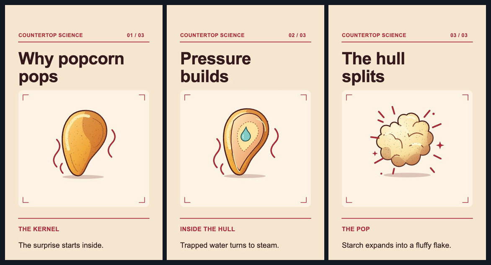

[Quick start](#quick-start) · [What you can make](#style-gallery) · [Choose a visual style](#choose-a-visual-style) · [How it works](#how-it-works) · [Your series look](#series-look) · [Revisions and reuse](#what-you-save) · [Install](#install) · [Uninstall](#uninstall) · [Questions](#questions) · [Technical guide](docs/guide.md)

<a id="quick-start"></a>

## 🚀 Quick start

1. Open **Claude Code** and type these two lines:

   ```
   /plugin marketplace add fatlhr/NaraFrame
   /plugin install naraframe@naraframe
   ```

2. Ask for a video, for example:

   ```
   Make a 20-second vertical explainer about why ice floats.
   ```

3. Say **yes** when your agent offers to install NaraFrame's engine (about 240 MB). It checks Node.js, Chrome and FFmpeg first and tells you if anything is missing.
4. Look at the preview, ask for changes in plain words, and approve. You get the MP4.

Using Codex or another agent? See [Install](#install). Want it gone later? [Uninstall](#uninstall) takes two commands.

## ✨ Why NaraFrame

- 🎨 **Every episode looks like your series.** A profile holds your colours, type, voice style and sourcing rules. Name your series and pick two colours, and NaraFrame builds the profile. Episode 12 then looks like episode 1 without anyone redoing the design.
- ✅ **You approve before anything is final.** Each episode goes preview → your approval → export, and the export is exactly the version you approved. Change one word afterwards and it asks you to look again.
- 🔁 **Revise an existing project.** Keep the source and recorded audio, change the episode, and undo revisions from its history. Compatible previews can be reused when their rendered content is unchanged.
- 🛡️ **Check before export.** The engine checks supported text layouts, motion bounds and rendered-frame integrity. Preview warnings identify content that needs your review.
- 📁 **Your files stay yours.** Rendering runs on your computer, and every video is a set of plain, editable source files.

<a id="style-gallery"></a>

## 🖼️ What you can make

Eight short, silent previews. Watch how each style uses movement to show an idea or tell a story.

| | |
|:---:|:---:|
| 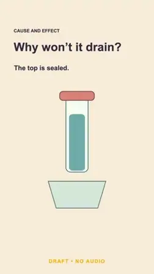<br>**Motion Explainer**<br>*Why won’t it drain?* | 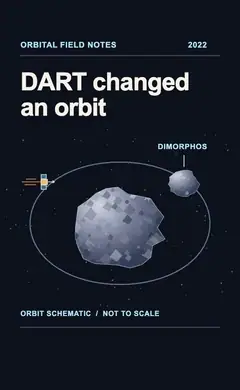<br>**Editorial / Current Issues**<br>*An asteroid nudge* |
| <br>**Stickman Ink**<br>*Kite in the Fence* | 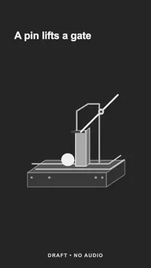<br>**Mechanic’s Bench**<br>*A pin lifts a gate* |
| 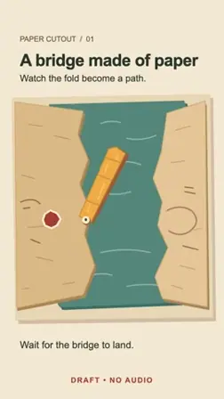<br>**Paper Cutout**<br>*A bridge made of paper* | 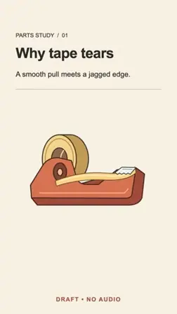<br>**Bedah 2.5D**<br>*Why tape tears* |
| 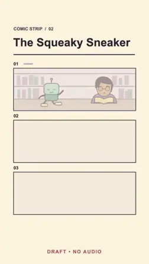<br>**Motion Comic**<br>*The Squeaky Sneaker* | 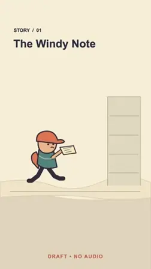<br>**Story**<br>*The Last Match* |

The DART example draws on [NASA’s orbital analysis](https://www.nasa.gov/missions/dart/nasa-study-asteroids-orbit-shape-changed-after-dart-impact/).

<a id="choose-a-visual-style"></a>

### Choose a visual style

A plain brief for a new video uses **Motion Explainer**. Choose a profile when its movement fits the story you want to tell. An ordinary revision keeps the episode’s selected profile.

| Style and profile ID | Best for | How to choose in Codex | Example |
|---|---|---|---|
| **Motion Explainer** · `general-explainer` | A process, comparison, or cause and effect | Start with a plain brief or choose `$naraframe` | [Why won’t it drain?](docs/assets/readme/profiles/general-explainer.webp) |
| **Editorial / Current Issues** · `current-issues` | A sourced explanation of an event | Choose `$naraframe` and ask for `current-issues` | [An asteroid nudge](docs/assets/readme/profiles/current-issues.webp) |
| **Stickman Ink** · `stickman-ink` | A pose, reaction, or interaction with a prop | Choose `$naraframe-stickman` | [Kite in the Fence](docs/assets/readme/profiles/stickman-ink.webp) |
| **Mechanic’s Bench** · `mechanics-bench` | A mechanism with connected parts | Choose `$naraframe-mechanics` | [A pin lifts a gate](docs/assets/readme/profiles/mechanics-bench.webp) |
| **Paper Cutout** · `paper-cutout` | Layers, folds, and stepped movement | Choose `$naraframe-paper` | [A bridge made of paper](docs/assets/readme/profiles/paper-cutout.webp) |
| **Bedah 2.5D** · `bedah-25d` | An exploded view of how an object fits together | Choose `$naraframe-3d` | [Why tape tears](docs/assets/readme/profiles/bedah-25d.webp) |
| **Motion Comic** · `motion-comic` | A short story told through panels and dialogue | Choose `$naraframe-comics` | [The Squeaky Sneaker](docs/assets/readme/profiles/motion-comic.webp) |
| **Story** · `story` | An action and consequence across shots | Choose `$naraframe-story` | [The Last Match](docs/assets/readme/profiles/story.webp) |

Install character skills from a matching source build or local engine archive. The published npm `0.2.0` package includes Stickman Ink, the original Mechanic’s Bench entry (`$naraframe-mekanik` with `meja-mekanik`), and Paper Cutout. [Install character skills and preview a pattern](docs/guide.md#character-skills)

<a id="how-it-works"></a>

## ⚙️ How it works

| Step | You | NaraFrame and your agent |
|:---:|---|---|
| 1️⃣ | **Ask:** "Make a 20-second explainer about why ice floats," or "Start a weekly series for my science channel." | Explains what NaraFrame does and, the first time, offers to install the engine. |
| 2️⃣ | **Pick the look:** one-off video, character style, or a series? | Uses the default explainer profile, the style you select, or a series profile made from your name and colours. |
| 3️⃣ | **Review:** "make the headline shorter," "slow the second scene down." | Shows a preview and a storyboard image, then changes only what you asked for. |
| 4️⃣ | **Approve and export.** | Delivers a 1080×1920 MP4 of exactly the version you approved. |

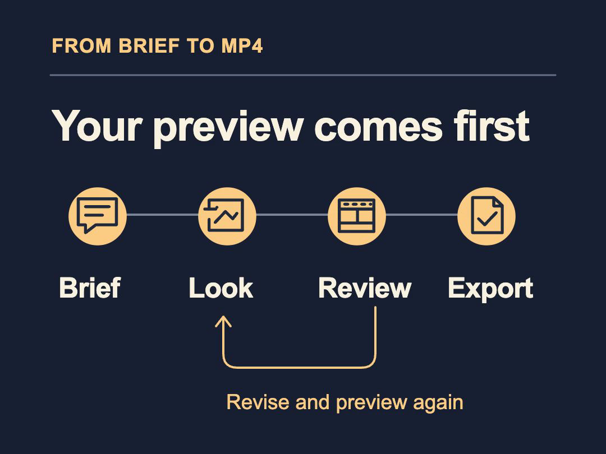

Every preview comes with a storyboard, so you can judge the whole video at a glance:

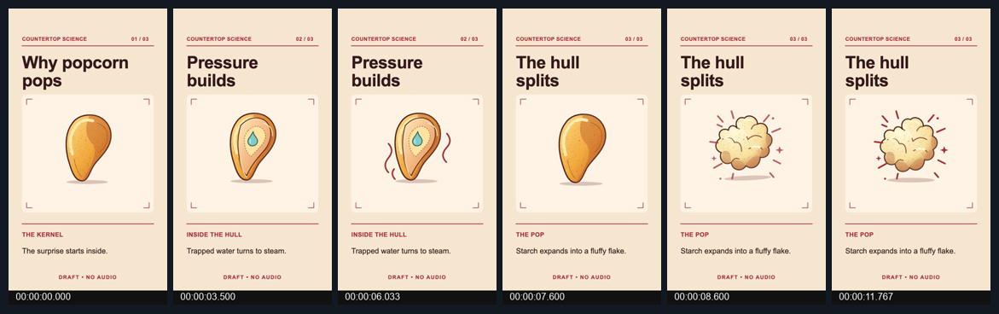

### 💬 What you can ask for

| You say | NaraFrame does |
|---|---|
| "Make a short vertical explainer about why cats love boxes, no narration." | A silent one-off explainer in the neutral look |
| "Start a weekly series called *Sains Santai*, dark green and yellow, in Indonesian." | Creates the series look, then the first episode |
| "Use this recorded voice-over and only caption the key phrases." | Imports your audio once and captions the phrases you pick |
| "Undo the last change." | Steps back one revision |
| "Show me what changes if this series moves to our new brand profile." | Lists what will change before applying anything |
| "I'm not ready to install anything. Just write me a shot-by-shot plan." | A written plan you can turn into a video later |

<details>
<summary><b>👀 Walk through an example session</b></summary>

Here is an example of the supported workflow, starting on a Mac without the engine.

> **You:** Start a weekly series for my science channel. First episode: why cats sleep in boxes, about 30 seconds, no voice for now.

The agent explains what NaraFrame does, asks whether you want it to install the engine, and asks for the series name and colours.

> **You:** Install it. The channel is *Sains Santai*, dark green and yellow, in Indonesian.

It installs the engine, creates the *Sains Santai* series look, writes the scenes and shows you a preview with a storyboard.

> **You:** Make the second headline shorter and slow the heat lines down.

It changes just those parts, checks them again and shows a new preview.

> **You:** Looks good. Export it.

You get the final MP4 of exactly the version you approved. Next week:

> **You:** Episode 2 of *Sains Santai*: why cats knead blankets.

The new episode starts with the same look as episode 1.

</details>

<a id="series-look"></a>

## 🎨 One look per series

The same scenes in two series looks. The content stays; colours, type and the timing of reveals follow the profile.

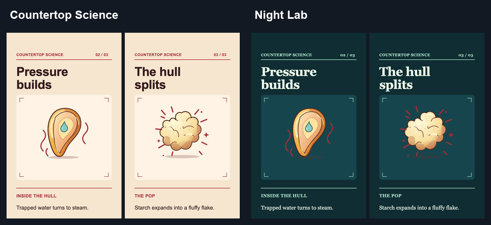

When you move a series to a new look, NaraFrame first shows what will change before anything is applied. Two of the videos above were moved to a new look this way, without redrawing anything.

### 🍱 The menus behind the looks

Your agent doesn't invent a style from scratch each time. It picks from a fixed set of building blocks, which is why the tenth episode still looks like the first.

| Menu | What's on it |
|---|---|
| 🎨 **Looks (profiles)** | Built-in explainer, editorial and character styles, plus custom series profiles. [Choose a visual style](#choose-a-visual-style) |
| 🎞️ **Shot patterns** | Explain an object, follow a route, compare numbers, pull back to show the bigger picture, land a headline, hold a quiet moment, pin notes to a picture |
| 🏃 **Moves** | Reveal, draw a line, follow along a path, count up, emphasise, focus, and camera pans and zooms |
| 🔀 **Transitions** | Cut, push through, reveal through a shape, or a match cut that carries the eye from one scene to the next |
| 💬 **Captions** | None, only the key phrases, or the full narration |
| 🔊 **Sound** | Your recorded voice-over, music, or silent |
| 📺 **Series extras** | An intro, a signature and a sign-off shared by every episode |

<a id="what-you-save"></a>

## 🔁 Revisions and reuse

| When you change | What is kept |
|---|---|
| A headline, colour or layout | Existing voice recordings stay in the project. |
| The next episode in a series | The profile supplies its fonts, palette and production preferences. |
| An editorial note that does not affect the render | A compatible preview can be reused. |
| Your mind about the last revision | `undo` restores the previous source revision. |

Source changes require a matching preview review before export. Render time depends on the video's length, composition and your computer.

<a id="install"></a>

## 📦 Install

### Claude Code

1. Add NaraFrame and install the plugin. Type both lines in Claude Code:

   ```
   /plugin marketplace add fatlhr/NaraFrame
   /plugin install naraframe@naraframe
   ```

2. Ask for a video in your own words.
3. The first time, your agent explains what NaraFrame does and offers to install its engine: one small program, about 240 MB, placed in `~/.naraframe`. Nothing is installed until you say yes.

Not ready to install the engine? Say no, and you can ask for a written shot-by-shot plan instead.

<details>
<summary><b>🤖 Codex and other agents</b></summary>

Use the [project-local install instructions](skills/naraframe/installation.md#install-the-skill-from-github) for `npx skills add`, or copy the complete `skills/naraframe` folder into your host's location below.

Then start a new session in that project and explicitly invoke `$naraframe` in Codex (or reference the installed `SKILL.md` in another agent). The engine install works the same way as in Claude Code. The skill works from any complete copy and never writes into its own folder.

| Agent | Where the skill goes |
|---|---|
| Codex | `~/.agents/skills/`, or `.agents/skills/` inside one project |
| Claude Code without the plugin | `~/.claude/skills/`, or `.claude/skills/` inside one project |
| Other agents | Copy the folder into the project and reference `SKILL.md` from the agent's instructions |

</details>

<details>
<summary><b>⌨️ Without an agent</b></summary>

The published engine also works directly from your terminal:

```bash
npx -y naraframe@0.2.0 doctor --json
```

The [technical guide](docs/guide.md#install-from-npm) covers installation, project files, previews, revisions and export.

</details>

<a id="what-you-need"></a>

### 🧰 What you need

| | What | Note |
|:---:|---|---|
| 🤖 | A skill-capable coding agent for the guided workflow | Claude Code or Codex; optional for direct CLI use |
| 🧩 | Node.js 22 or newer, Google Chrome, FFmpeg | Your agent checks these and tells you if anything is missing |
| 🧪 | Tested on Macs with Apple Silicon | Other systems are not verified yet |

<a id="uninstall"></a>

## 🧹 Uninstall

1. Remove the plugin. In Claude Code:

   ```
   /plugin uninstall naraframe@naraframe
   /plugin marketplace remove naraframe
   ```

   For Codex or another agent, delete the copied `naraframe` folder from its skills folder instead.

2. Remove the engine. In a terminal:

   ```bash
   rm -rf ~/.naraframe
   ```

Your video projects and exported MP4s live in your own folders and are not touched. Tools your agent installed for you, such as FFmpeg, stay installed; remove them the usual way if you no longer need them.

<a id="good-to-know"></a>

## 📌 Good to know

- 🌱 NaraFrame is an early release (0.2.0). Expect rough edges, and please report them in the issues.
- 🎞️ It animates with a fixed set of moves: reveals, camera moves, transitions, counters and drawn paths. It suits clear explainers; it is not a free-form animation tool.
- 🔎 Facts on screen are your responsibility. NaraFrame helps you label claims and cite sources, and a profile can require sources before export, but it cannot check facts for you.
- 📤 An export is a video file on your computer. Where you post it is up to you.

<a id="questions"></a>

## ❓ Questions

<details>
<summary><b>Is it free?</b></summary>

NaraFrame's own code is free and open source under the MIT License. Rendering uses Remotion under its [separate licensing terms](https://www.remotion.dev/license). Agent subscriptions and any media-generation services you choose have their own costs.

</details>

<details>
<summary><b>Does it need the internet?</b></summary>

Installing the engine and skill requires internet access. Rendering prepared local media runs on your computer; your agent or any generation service may need its own connection.

</details>

<details>
<summary><b>Can I use my own voice?</b></summary>

Yes. Bring a recorded voice-over and its phrase timing; NaraFrame imports it once and keeps it unchanged while you revise the visuals.

</details>

<details>
<summary><b>Can I edit the video myself?</b></summary>

Yes. Every video is a set of plain source files, and the command line works without an agent. See the [technical guide](docs/guide.md).

</details>

<details>
<summary><b>Does it work on Windows or Linux?</b></summary>

Not yet verified. Today NaraFrame is tested on Macs with Apple Silicon only.

</details>

<details>
<summary><b>Does it post to TikTok, Reels or Shorts?</b></summary>

No. It exports an MP4 to your computer, and you post it where you like.

</details>

<details>
<summary><b>Which AI made the videos on this page?</b></summary>

Claude Sonnet 5.5, running the NaraFrame skill in Claude Code. NaraFrame itself does not include an AI model; it works with the agent you already use.

</details>

## 📄 License

NaraFrame's own code is released under the [MIT License](LICENSE).

Rendering uses [Remotion](https://www.remotion.dev/license) under its own licensing terms. See [THIRD-PARTY-NOTICES.md](THIRD-PARTY-NOTICES.md) for dependency notices.

## 📚 Learn more

- 📘 [Technical guide](docs/guide.md): engine installation, the command line, project files, revisions and troubleshooting.
- 🧠 [The skill](skills/naraframe/SKILL.md): what your agent reads.
