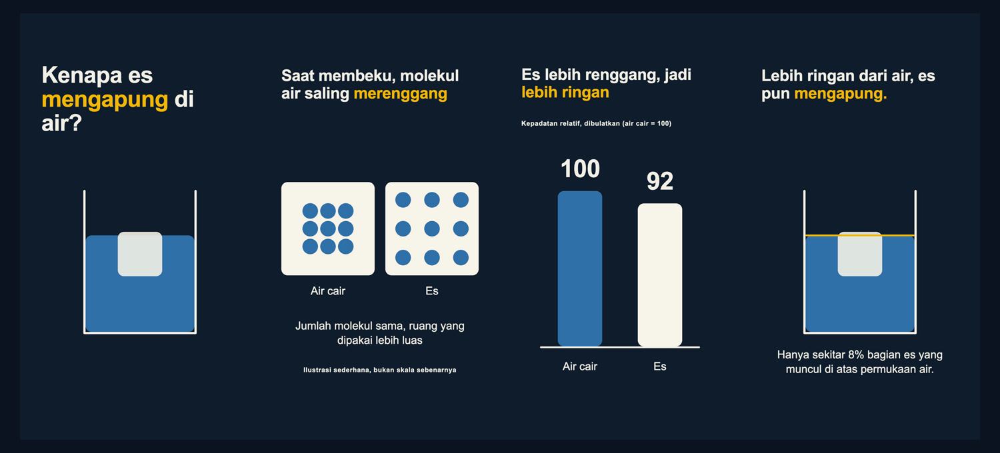
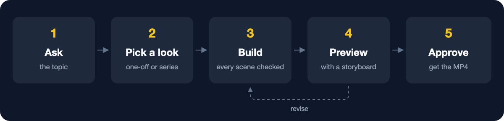
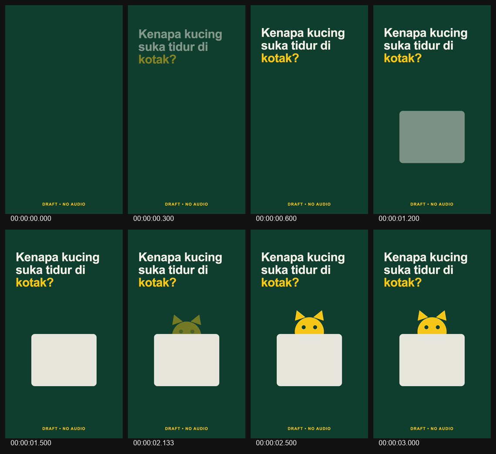
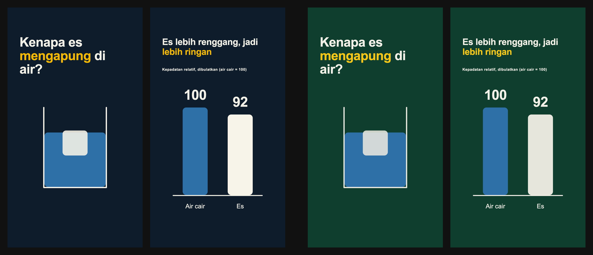

# NaraFrame

**Short vertical explainer videos for your series, made by the AI agent you already use.**

[](LICENSE)
[](#what-you-need)
[](#good-to-know)
[](#install)

Tell your agent what the next episode is about. NaraFrame turns that into a 9:16 video with the same look as every episode before it, shows you a preview, and exports exactly the version you approved.



[Install](#install) · [How it works](#how-it-works) · [Gallery](#style-gallery) · [What you save](#what-you-save) · [Questions](#questions) · [Technical guide](docs/guide.md)

## ✨ Why NaraFrame

- 🎨 **Every episode looks like your series.** A profile holds your colours, type, voice style and sourcing rules. Name your series and pick two colours, and NaraFrame builds the profile. Episode 12 then looks like episode 1 without anyone redoing the design.
- ✅ **You approve before anything is final.** Each episode goes preview → your approval → export, and the export is exactly the version you approved. Change one word afterwards and it asks you to look again.
- ⚡ **Revisions are fast and cheap.** NaraFrame keeps every episode as a project, so a change edits only what you asked for, and every change is saved in a history you can undo. In our tests a revision was nearly twice as fast as starting over ([what you save](#what-you-save)).
- 🛡️ **Mistakes are caught before your audience sees them.** Text that doesn't fit, text that slides off screen during a transition and corrupted frames stop the export. Text that drifts outside the part of the screen a phone app keeps clear gets a warning.
- 📁 **Your files stay yours.** Rendering runs on your computer, and every video is a set of plain, editable source files.

## 🎬 What you can make

Short vertical videos (9:16, 1080×1920) that explain one idea clearly, especially when you make them every week.

| | Video | What it looks like |
|:---:|---|---|
| 🔬 | **How something works** | A diagram builds itself step by step while the headline says what to look at. |
| 📊 | **Comparisons and numbers** | Bars and counters land on the figure, with the unit and the qualifier kept readable. |
| 🗺️ | **Processes and routes** | A line draws itself from step to step, and an object can travel along it. |
| 🖼️ | **A picture with pointers** | Your own image, cropped where you choose, with notes that point at the parts that matter. |
| 📺 | **A series with a recognisable opening** | An intro, a signature and a sign-off that every episode shares. |
| 🎙️ | **Narrated or silent** | A recorded voice-over with captions on the key phrases, music only, or no sound at all. |

<a id="how-it-works"></a>

## ⚙️ How it works

| Step | You | NaraFrame and your agent |
|:---:|---|---|
| 1️⃣ | **Ask:** "Make a 20-second explainer about why ice floats," or "Start a weekly series for my science channel." | Explains what NaraFrame does and, the first time, offers to install the engine. |
| 2️⃣ | **Pick the look:** one-off video or a series? | Uses a neutral explainer look, or creates your series look from a name and colours. |
| 3️⃣ | **Review:** "make the headline shorter," "slow the second scene down." | Shows a preview and a storyboard image, then changes only what you asked for. |
| 4️⃣ | **Approve and export.** | Delivers a 1080×1920 MP4 of exactly the version you approved. |



Every preview comes with a storyboard, so you can judge the whole video at a glance:



<a id="what-you-save"></a>

## 💰 What you save

| You save | How | Measured |
|---|---|---|
| ⏱️ **Time on the first draft** | Your agent installs NaraFrame, picks the look and writes the scenes for you. | From "make me a video" to a preview in about **4 minutes**, including the install |
| 🔁 **Time and tokens on every revision** | A change edits only what you asked for. | Nearly **2× faster** and about **20% fewer AI tokens** than making it again from scratch |
| 🎨 **Setting up a series** | A series look comes from a name and two colours. | Done in **seconds** |
| 🎙️ **Re-recording** | A recorded voice-over is imported once; changes to words on screen, colours or timing keep the audio as it is. | **No re-record** for visual changes |
| 🧪 **Renders that were never going to work** | NaraFrame checks a project before anything is rendered. | Checks take **seconds**, a render about a minute |
| ♻️ **Rendering twice** | If nothing changed, the earlier video is reused. | **Instant** |

Measurements come from our own tests with first-time agents on an Apple Silicon Mac.

## 🖌️ One look per series

The same scenes in two series looks. The content stays; colours, type and the timing of reveals follow the profile.



When you move a series to a new look, NaraFrame first shows what will change before anything is applied.

<a id="style-gallery"></a>

## 🖼️ Style gallery

Every video below comes from NaraFrame, made by an agent from this repository's profiles and drawings.

| | | |
|:---:|:---:|:---:|
|  |  | *News explainer with sources: image coming soon* |
| **🔬 Science explainer**<br>Neutral explainer look | **📺 Weekly series**<br>A series look from a name and two colours | **📰 News and current affairs**<br>Editorial look that requires sources |
| *Paper and ink: image coming soon* | *Route diagram: image coming soon* | *Picture with pointers: image coming soon* |
| **📄 Paper and ink**<br>Light, quiet editorial look | **🗺️ Route or process**<br>A path that draws itself | **🖼️ Picture with pointers**<br>Notes pinned to an image |

## 🍱 The menus behind the looks

Your agent doesn't invent a style from scratch each time. It picks from a fixed set of building blocks, which is why the tenth episode still looks like the first.

| Menu | What's on it |
|---|---|
| 🎨 **Looks (profiles)** | A neutral explainer look, an editorial look that requires sources, or your own series look from a name and colours |
| 🎞️ **Shot patterns** | Explain an object, follow a route, compare numbers, pull back to show the bigger picture, land a headline, hold a quiet moment, pin notes to a picture |
| 🏃 **Moves** | Reveal, draw a line, follow along a path, count up, emphasise, focus, and camera pans and zooms |
| 🔀 **Transitions** | Cut, push through, reveal through a shape, or a match cut that carries the eye from one scene to the next |
| 💬 **Captions** | None, only the key phrases, or the full narration |
| 🔊 **Sound** | Your recorded voice-over, music, or silent |
| 📺 **Series extras** | An intro, a signature and a sign-off shared by every episode |

## 💬 What you can ask for

| You say | NaraFrame does |
|---|---|
| "Make a short vertical explainer about why cats love boxes, no narration." | A silent one-off explainer in the neutral look |
| "Start a weekly series called *Sains Santai*, dark green and yellow, in Indonesian." | Creates the series look, then the first episode |
| "Use this recorded voice-over and only caption the key phrases." | Imports your audio once and captions the phrases you pick |
| "Undo the last change." | Steps back one revision |
| "Show me what changes if this series moves to our new brand profile." | Lists what will change before applying anything |
| "I'm not ready to install anything. Just write me a shot-by-shot plan." | A written plan you can turn into a video later |

<details>
<summary><b>👀 Walk through an example session</b></summary>

Here is how a session goes, starting on a Mac without the engine. The setup, the first draft in about four minutes and the export come straight from our tests.

> **You:** Start a weekly series for my science channel. First episode: why cats sleep in boxes, about 30 seconds, no voice for now.

The agent explains what NaraFrame does, asks whether you want it to install the engine, and asks for the series name and colours.

> **You:** Install it. The channel is *Sains Santai*, dark green and yellow, in Indonesian.

It installs the engine, creates the *Sains Santai* series look, writes the scenes and shows you a preview with a storyboard.

> **You:** Make the second headline shorter and slow the heat lines down.

It changes just those parts, checks them again and shows a new preview.

> **You:** Looks good. Export it.

You get the final MP4 of exactly the version you approved. Next week:

> **You:** Episode 2 of *Sains Santai*: why cats knead blankets.

The new episode starts with the same look as episode 1.

</details>

<a id="install"></a>

## 📦 Install

**Claude Code**, in two lines:

```
/plugin marketplace add fatlhr/NaraFrame
/plugin install naraframe@naraframe
```

Then ask for a video. The first time, your agent explains what NaraFrame does and offers to install its engine: one small program, about 240 MB, usually under a minute, placed in `~/.naraframe`. Nothing is installed until you say yes. Not ready? Choose the plan-only option and get a written shot-by-shot plan instead.

<details>
<summary><b>🤖 Codex and other agents</b></summary>

Copy the [`skills/naraframe`](skills/naraframe) folder into your agent's skills folder, or point your agent's instructions at `skills/naraframe/SKILL.md`. The skill works from any copy and never writes into its own folder.

| Agent | Where the skill goes |
|---|---|
| Codex | `.agents/skills/` in your project, or `~/.agents/skills/` |
| Claude Code without the plugin | `.claude/skills/` in your project, or `~/.claude/skills/` |
| Other agents | Copy the folder into the project and reference `SKILL.md` from the agent's instructions |

</details>

<details>
<summary><b>⌨️ Without an agent</b></summary>

The engine is a command-line tool. Installing it yourself, building from source and every command are covered in the [technical guide](docs/guide.md).

</details>

<a id="what-you-need"></a>

## 🧰 What you need

| | Requirement | Note |
|:---:|---|---|
| 💻 | A Mac with Apple Silicon | The only platform verified so far |
| 🧩 | Node.js 24.20, Google Chrome, FFmpeg | Your agent checks these and tells you if anything is missing |
| 🤖 | An AI coding agent that supports skills | For example Claude Code or Codex |

<a id="good-to-know"></a>

## 📌 Good to know

- 🌱 NaraFrame is an early release (0.1.0). Expect rough edges, and please report them in the issues.
- 🎞️ It animates with a fixed set of moves: reveals, camera moves, transitions, counters and drawn paths. It suits clear explainers; it is not a free-form animation tool.
- 🔎 Facts on screen are your responsibility. NaraFrame helps you label claims and cite sources, and a profile can require sources before export, but it cannot check facts for you.
- 📤 An export is a video file on your computer. Where you post it is up to you.

<a id="questions"></a>

## ❓ Questions

<details>
<summary><b>Is it free?</b></summary>

NaraFrame is free and open source under the MIT License. It renders with Remotion, which is free for individuals, non-profits and companies with up to three employees; larger companies need a Remotion company licence. Your AI agent's own usage is billed by its provider as usual.

</details>

<details>
<summary><b>Does it need the internet?</b></summary>

Only to install it. Rendering runs on your computer. Your AI agent works the way it always does.

</details>

<details>
<summary><b>Can I use my own voice?</b></summary>

Yes. Bring a recorded voice-over and its phrase timing; NaraFrame imports it once and keeps it unchanged while you revise the visuals.

</details>

<details>
<summary><b>Can I edit the video myself?</b></summary>

Yes. Every video is a set of plain source files, and the command line works without an agent. See the [technical guide](docs/guide.md).

</details>

<details>
<summary><b>Does it work on Windows or Linux?</b></summary>

Not yet verified. Today NaraFrame is tested on Macs with Apple Silicon only.

</details>

<details>
<summary><b>Does it post to TikTok, Reels or Shorts?</b></summary>

No. It exports an MP4 to your computer, and you post it where you like.

</details>

## 📄 License

NaraFrame's own code is released under the [MIT License](LICENSE).

NaraFrame renders video with [Remotion](https://www.remotion.dev), which has its own licence: it is free for individuals, non-profits and companies with up to three employees, and larger companies need a Remotion company licence. See [THIRD-PARTY-NOTICES.md](THIRD-PARTY-NOTICES.md) for every dependency and its terms.

## 📚 Learn more

- 📘 [Technical guide](docs/guide.md): installing from source, the command line, project files, revisions and troubleshooting.
- 🧠 [The skill](skills/naraframe/SKILL.md): what your agent reads.
- 🗂️ [Product specification](docs/spec.md) and [development plan](docs/plan.md).
